#+TITLE: Persian Landscapes
#+AUTHOR: Komeil Parseh
#+EMAIL: komeilparseh@disroot.org
#+DATE: 2026-11-05
#+KEYWORDS: emacs themes modus accessibility
#+DESCRIPTION: A family of eight GNU Emacs themes built on modus-themes.

#+begin_note
*Important:* This project and its palettes were generated with the help of LLMs/AI. The color ideas may be derived from or resemble other existing theme projects, and I have not independently verified or audited them beyond the automated contrast/loading tests described below. Use at your own discretion, and verify colors against your own accessibility requirements before relying on them.
#+end_note

* Persian Landscapes

A family of eight GNU Emacs themes built on the official [[https://protesilaos.com/emacs/modus-themes][Modus Themes]] framework.

Four independent visual themes, each with a dark and light variant:

| Theme | Dark variant | Light variant | Identity                                                                           |
|-------+--------------+---------------+------------------------------------------------------------------------------------|
| Anar  | anar-dark    | anar-light    | Pomegranate: muted pomegranate skin, rose, pistachio, warm gold, subdued turquoise |
| Kavir | kavir-dark   | kavir-light   | Desert: warm stone, sand, clay, muted copper, dry sage, dusk blue                  |
| Kashi | kashi-dark   | kashi-light   | Lapis: deep blue-gray, cobalt, turquoise, sage, aged gold                          |
| Goy   | goy-dark     | goy-light     | Glaze: Tabriz/Blue Mosque glazed surfaces, mineral blue, turquoise, sage           |

These are eight independent themes, not one theme with interchangeable accent colors.

*Requirements:* GNU Emacs 28.1+ (tested with Emacs 31.1) and ~modus-themes~ 5.x (installed: modus-themes 20261031.1702).

*Installation:*

#+begin_src elisp
(add-to-list 'load-path "path/to/persian-landscapes")
(add-to-list 'custom-theme-load-path "path/to/persian-landscapes")

(require 'persian-landscapes-themes) ; optional; adds the directory automatically
(load-theme 'anar-dark t)
#+end_src

Theme files are named ~NAME-theme.el~ (e.g. ~anar-dark-theme.el~) and each ~(require 'persian-landscapes-themes)~ so the shared palette library loads first. No other part of your Emacs configuration is modified.

*Convenience commands:*

- ~persian-landscapes-select~: pick a variant with completion
- ~persian-landscapes-toggle~:  toggle between dark/light variants of the current theme
- ~persian-landscapes-rotate~: cycle through all eight variants

| Variant     | Command to load             |
|-------------+-----------------------------|
| Anar Dark   | ~(load-theme 'anar-dark t)~   |
| Anar Light  | ~(load-theme 'anar-light t)~  |
| Kavir Dark  | ~(load-theme 'kavir-dark t)~  |
| Kavir Light | ~(load-theme 'kavir-light t)~ |
| Kashi Dark  | ~(load-theme 'kashi-dark t)~  |
| Kashi Light | ~(load-theme 'kashi-light t)~ |
| Goy Dark    | ~(load-theme 'goy-dark t)~    |
| Goy Light   | ~(load-theme 'goy-light t)~   |

*Preview buffer:*

#+begin_src elisp
M-x persian-landscapes-preview
#+end_src

This opens ~*Persian Landscapes Preview*~ showing syntax, Org headings/TODO/DONE, diff add/remove/change, region, and mode-line faces.

* Screenshots

Real Emacs frame previews for each variant (under ~screenshots/~). Images are shown at ~280px~ wide for web viewing.

#+ATTR_HTML: :width 280
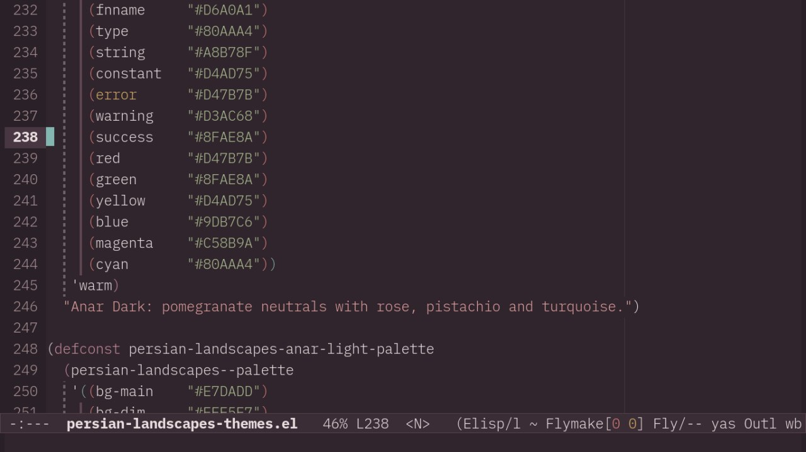

#+ATTR_HTML: :width 280
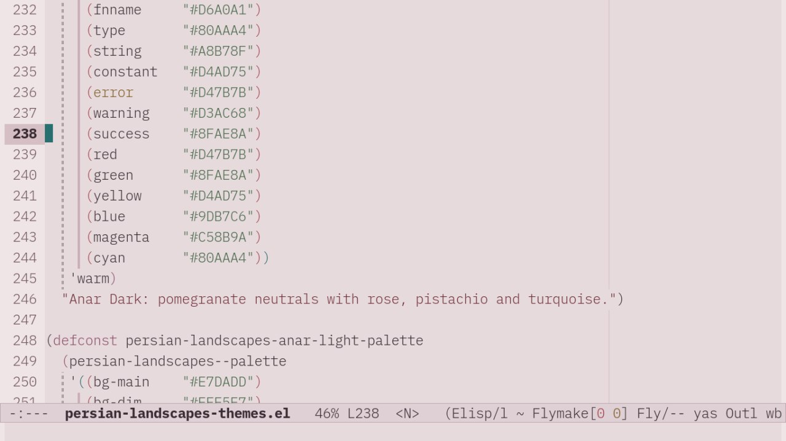

#+ATTR_HTML: :width 280
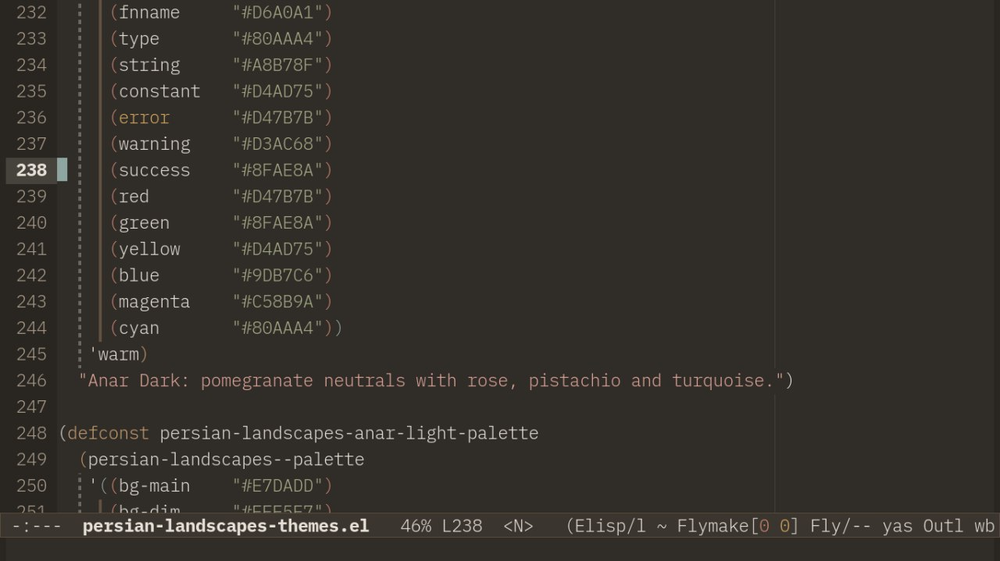

#+ATTR_HTML: :width 280
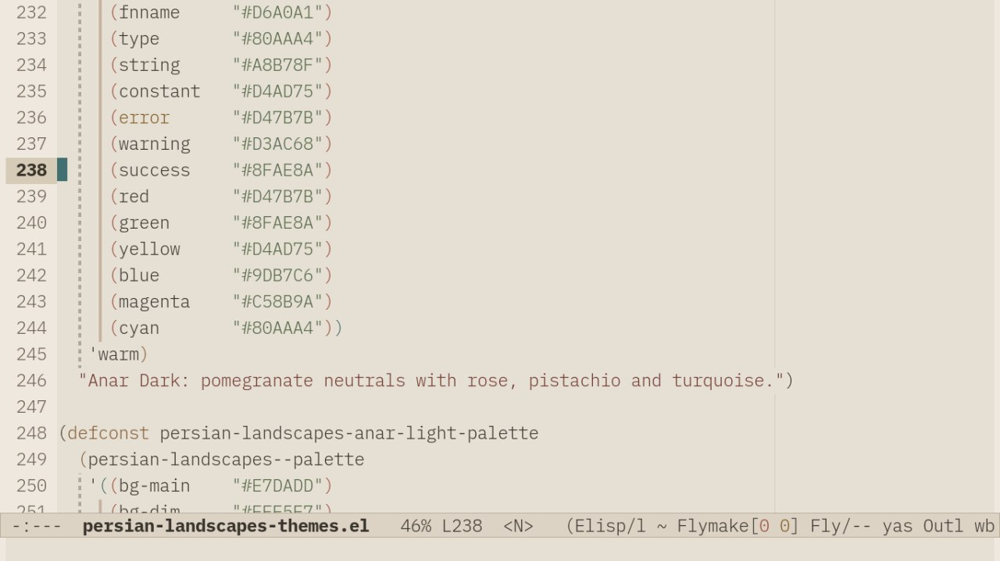

#+ATTR_HTML: :width 280
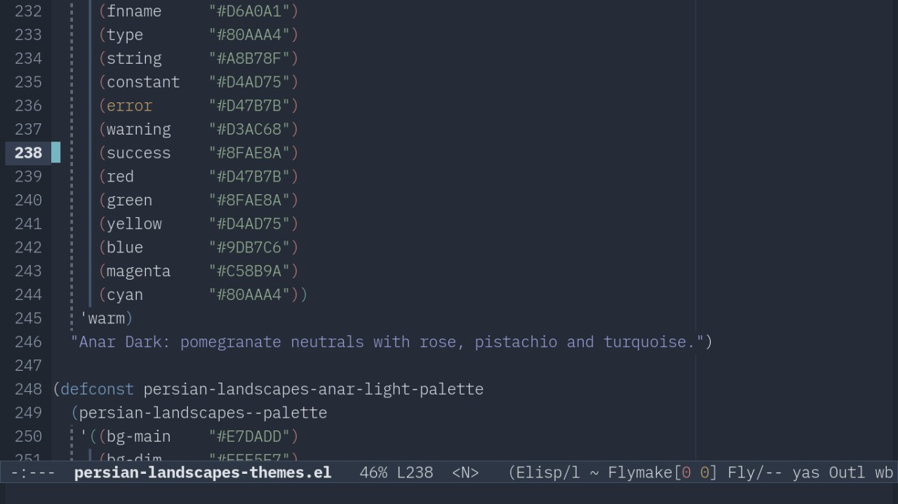

#+ATTR_HTML: :width 280
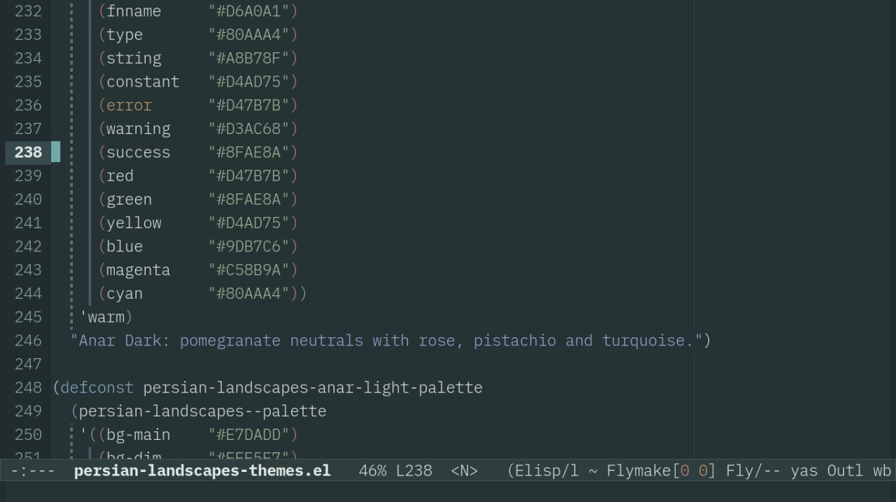

#+ATTR_HTML: :width 280
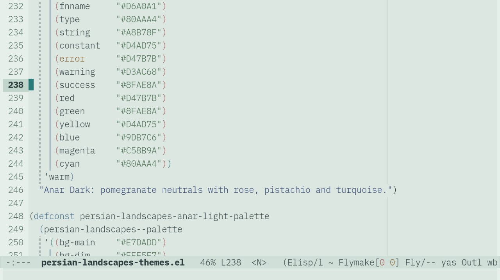

* Palette images

Each variant's complete palette as swatches (SVG + PNG under ~palette-images/~):

| Anar Dark                          | Anar Light                          |
|------------------------------------+-------------------------------------|
| 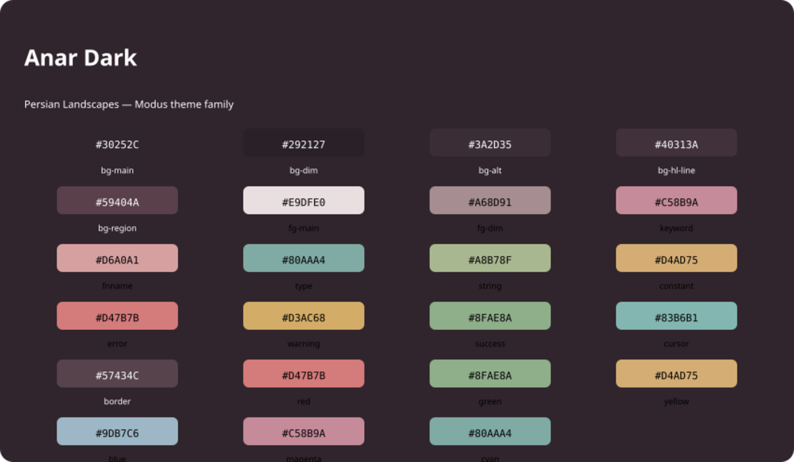  | 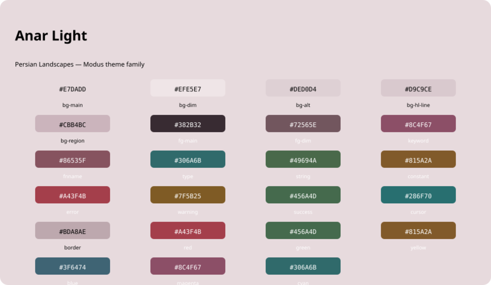  |
| Kavir Dark                         | Kavir Light                         |
| 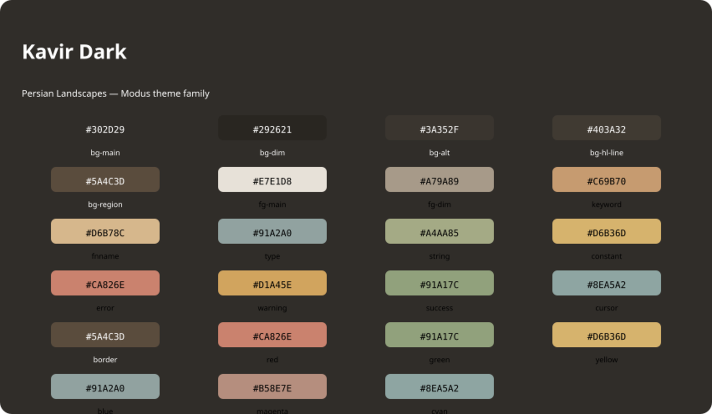 | 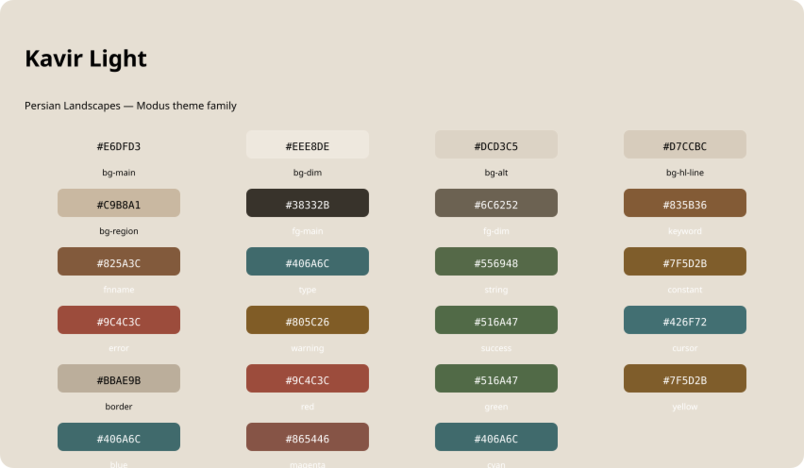 |
| Kashi Dark                         | Kashi Light                         |
| 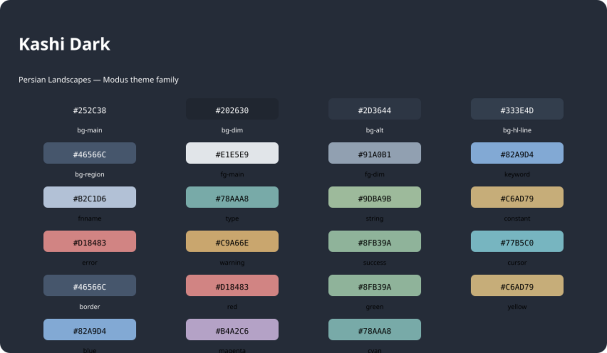 | 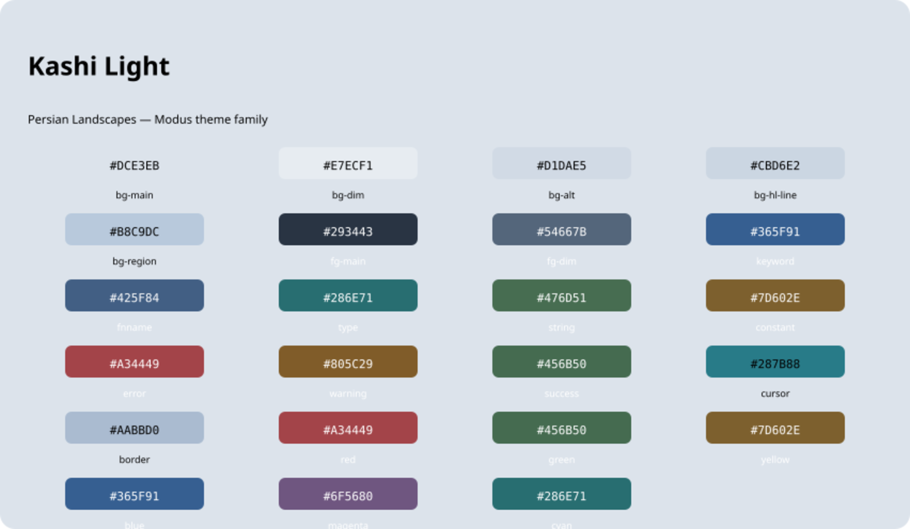 |
| Goy Dark                           | Goy Light                           |
| 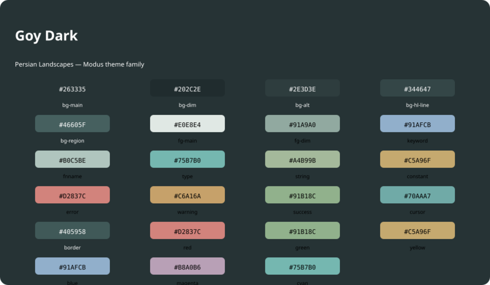   | 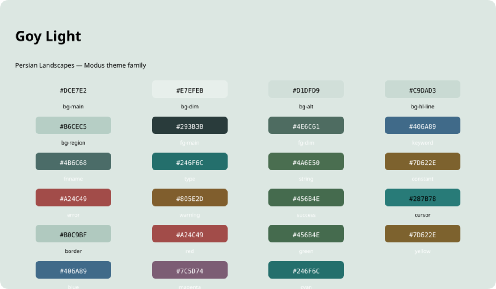   |

Generated palette swatches for all eight variants are committed under ~palette-images/~ (SVG + PNG) and shown above. They document the base colors only; to capture real Emacs frame previews, run Emacs graphically, load each variant, and run ~M-x persian-landscapes-preview~. Batch tests validate loading and contrast, not pixel-perfect rendering.

* Palettes

Each variant is a complete Modus palette produced by ~modus-themes-generate-palette~ from canonical base colors. The generator fills all derived variants (warmer/cooler/faint/intense, subtle/nuanced/intense backgrounds, search, diff, mode-line, tab-line, completion, Org, Dired, Magit, and diagnostic mappings) and guarantees no missing palette entries.

Adjusted values marked with ~*~ were darkened minimally to reach 4.5:1 on ~bg-main~; see Contrast audit below.

| Variant     | bg-main | fg-main | keyword  | fnname   | type     | string   | constant | error    | warning  | success  | cursor  | border  |
|-------------+---------+---------+----------+----------+----------+----------+----------+----------+----------+----------+---------+---------|
| Anar Dark   | #30252C | #E9DFE0 | #C58B9A  | #D6A0A1  | #80AAA4  | #A8B78F  | #D4AD75  | #D47B7B  | #D3AC68  | #8FAE8A  | #83B6B1 | #57434C |
| Anar Light  | #E7DADD | #382B32 | #8C4F67* | #86535F* | #306A6B* | #49694A* | #815A2A* | #A43F4B  | #7F5B25* | #456A4D* | #286F70 | #BDA8AE |
| Kavir Dark  | #302D29 | #E7E1D8 | #C69B70  | #D6B78C  | #91A2A0  | #A4AA85  | #D6B36D  | #CA826E* | #D1A45E  | #91A17C  | #8EA5A2 | #5A4C3D |
| Kavir Light | #E6DFD3 | #38332B | #835B36* | #825A3C  | #406A6C* | #556948* | #7F5D2B* | #9C4C3C* | #805C26  | #516A47* | #426F72 | #BBAE9B |
| Kashi Dark  | #252C38 | #E1E5E9 | #82A9D4  | #B2C1D6  | #78AAA8  | #9DBA9B  | #C6AD79  | #D18483  | #C9A66E  | #8FB39A  | #77B5C0 | #46566C |
| Kashi Light | #DCE3EB | #293443 | #365F91  | #425F84  | #286E71* | #476D51* | #7D602E* | #A34449  | #805C29  | #456B50  | #287B88 | #AABBD0 |
| Goy Dark    | #263335 | #E0E8E4 | #91AFCB  | #B0C5BE  | #75B7B0  | #A4B99B  | #C5A96F  | #D2837C* | #C6A16A  | #91B18C  | #70AAA7 | #405958 |
| Goy Light   | #DCE7E2 | #293B3B | #406A89* | #4B6C68* | #246F6C  | #4A6E50* | #7D622E* | #A24C49* | #805E2D  | #456B4E  | #287B78 | #B0C9BF |

The six hue families map to ~red=error~, ~green=success~, ~yellow=constant~, ~blue=identity~ accent, ~magenta=derived~ identity accent, ~cyan=type~ per theme, keeping each variant's identity.

*Original: adjusted canonical colors (marked ~*~):*

| Original                     | Adjusted | Ratio before -> after |
|------------------------------+----------+-----------------------|
| Anar Light keyword #92536C   | #8C4F67  | 4.21 -> 4.51          |
| Anar Light fnname #8F5965    | #86535F  | 4.09 -> 4.53          |
| Anar Light type #326F70      | #306A6B  | 4.25 -> 4.55          |
| Anar Light string #4E704F    | #49694A  | 4.12 -> 4.55          |
| Anar Light constant #89602D  | #815A2A  | 4.10 -> 4.51          |
| Anar Light warning #805B25   | #7F5B25  | 4.50 -> 4.52          |
| Anar Light success #456B4D   | #456A4D  | 4.47 -> 4.52          |
| Kavir Dark error #C77C67     | #CA826E  | 4.24 -> 4.52          |
| Kavir Light fg-dim #716655   | #6C6252  | 4.25 -> 4.52          |
| Kavir Light keyword #8A5F39  | #835B36  | 4.20 -> 4.51          |
| Kavir Light type #426E70     | #406A6C  | 4.29 -> 4.54          |
| Kavir Light string #586D4A   | #556948  | 4.29 -> 4.53          |
| Kavir Light constant #89652E | #7F5D2B  | 4.00 -> 4.53          |
| Kavir Light error #A34F3F    | #9C4C3C  | 4.23 -> 4.52          |
| Kavir Light success #526C48  | #516A47  | 4.41 -> 4.53          |
| Kashi Light fg-dim #586B80   | #54667B  | 4.24 -> 4.55          |
| Kashi Light type #286F72     | #286E71  | 4.50 -> 4.56          |
| Kashi Light string #4D7657   | #476D51  | 4.01 -> 4.54          |
| Kashi Light constant #80632F | #7D602E  | 4.34 -> 4.53          |
| Goy Dark error #D17F78       | #D2837C  | 4.37 -> 4.53          |
| Goy Light keyword #426D8C    | #406A89  | 4.36 -> 4.55          |
| Goy Light fnname #4D706B     | #4B6C68  | 4.31 -> 4.55          |
| Goy Light string #4F7655     | #4A6E50  | 4.09 -> 4.56          |
| Goy Light constant #80652F   | #7D622E  | 4.34 -> 4.53          |
| Goy Light error #A34D49      | #A24C49  | 4.46 -> 4.52          |

Line-highlight (~bg-hl-line~) preserves canonical values; text on that transient surface may fall slightly below 4.5:1.

* Contrast audit

WCAG ratios measured with ~modus-themes-contrast~ against actual backgrounds used by each face.

Targets met for every audited pair:

- Main text on ~bg-main~: 6.9:1–11.3:1 (≥ 7:1)
- Secondary text/comments on ~bg-main~: 4.5:1–5.8:1 (≥ 4.5:1)
- Selection foreground on ~bg-region~: 5.4:1–7.5:1
- Mode line active/inactive: 8.5:1–10.0:1 / 4.9:1–5.7:1
- Line numbers inactive: 4.9:1–5.7:1
- Org headings 2–7 on ~bg-main~: ≥ 4.5:1
- Diff text on diff backgrounds: ≥ 6.4:1 (foregrounds use ~fg-main~ on nuanced semantic backgrounds)
- Search/isearch text on search backgrounds: ≥ 6.2:1
- Eldoc active argument/value: ≥ 6.5:1
- Links: ≥ 4.5:1

Important status information does not rely on color alone: diffs combine semantic backgrounds with +/- fringe markers, and diagnostics use underlines plus foreground text.

* Architecture
- ~persian-landscapes-themes.el~ — shared library: ~modus-themes~ require, ~persian-landscapes--palette~ helper wrapping ~modus-themes-generate-palette~, the eight ~persian-landscapes-*-palette~ defconsts, shared semantic mappings, family convenience commands, and ~persian-landscapes-preview~.
- ~*-theme.el~ — eight independent theme files. Each calls ~modus-themes-theme~ with its generated palette as the core palette, no user or override palettes, and ~provide~s its ~NAME-theme~ feature. Each is registered in ~modus-themes-registered-items~ under family ~persian-landscapes~.

*License:* GPL-3.0-or-later.
